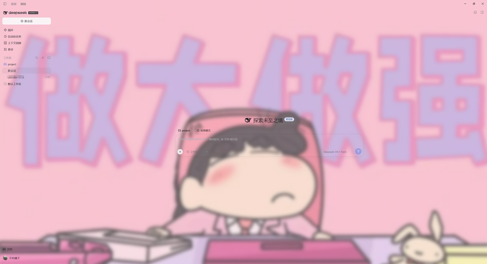
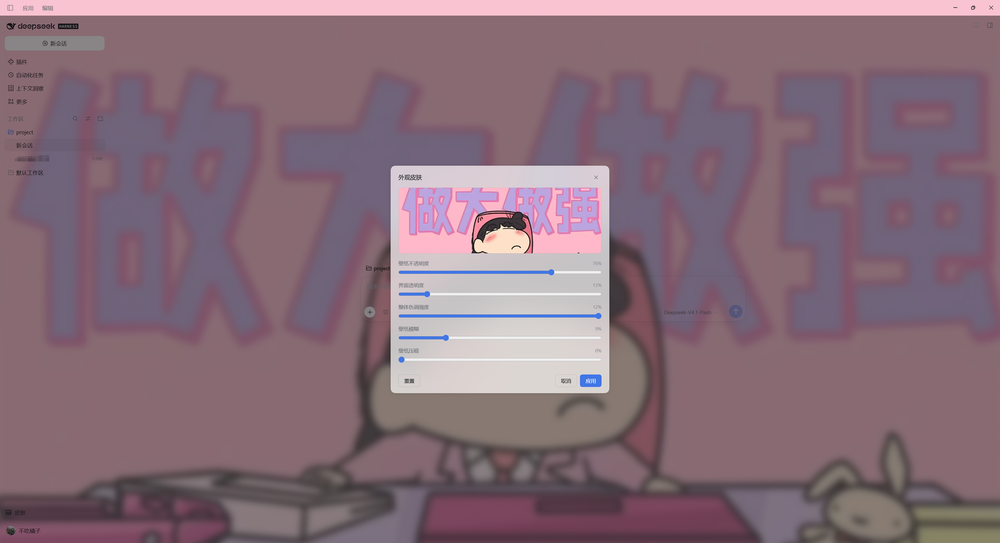
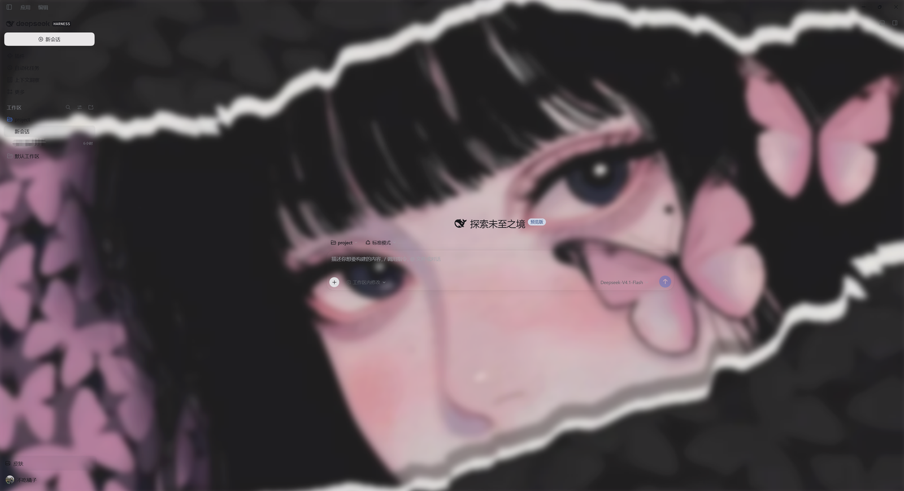
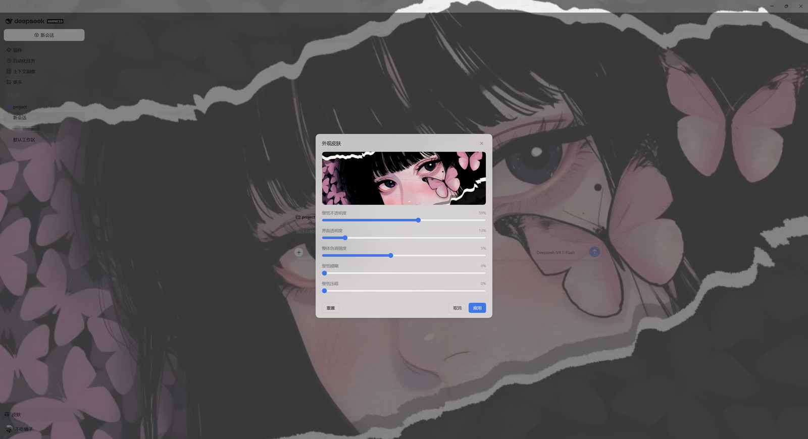

# oranges-dsh-skin

A wallpaper skin for the [DeepSeek Harness](https://github.com/deepseek-ai/deepseek-harness) Web client.
One button at the sidebar foot opens a dialog where a dropped image becomes the interface
wallpaper, and the surfaces either **blend** with it or **show it through**.


## Install

```sh
# from this repository
dsh plugin --profile <profile> add github:notEatingOranges/oranges-dsh-skin
```

Or in the app: **Plugins → Add plugin**, and pick the checkout directory. Restart once if the
button does not appear; the row shows up as **oranges-dsh-skin** under Plugins.

Requires DSH `>=0.2.0-rc.0` (declared in `engines.dsh`). Web surface only — this bundle has no
Host half and adds no model requests or tools.

## Use

1. Click **Skin** at the bottom of the left sidebar, directly above **Settings**.
2. Drop an image into the dialog (or click the box, or paste from the clipboard).
3. Pick a surface treatment — **Blend** or **Show through** — and adjust the sliders; the page
   repaints live.
4. **Apply** keeps the skin, **Cancel** restores what was applied before, **Reset** removes the
   image and the stored settings.

While the dialog is open it owns every file drag in the window: the dialog's dashed box
highlights, a drop anywhere else does nothing, and the composer's own full-page drop mask never
appears. Close the dialog to hand dragging back to the composer.

## Two ways to wear the image

**Blend** (default) keeps every surface opaque and mixes the wallpaper's average colour into it —
the page, the composer, cards and panels all take on the image's palette without letting anything
show through. Text contrast is untouched, and no dialog can appear to sit on top of another.

**Show through** turns the surfaces translucent so the image is visible behind them. It is capped
per tier — 55% for the page and sidebar, 30% for the composer, 12% for cards and panels — and the
wallpaper blurs itself as the slider rises (up to 20 px), because fine detail behind text is what
makes it unreadable. Dialogs are never made translucent: anything that declares itself a dialog
keeps a 96%-opaque surface with a 20 px backdrop blur.

## Where the state lives

- The image is downscaled to at most 2560 px on its long edge, re-encoded as WebP, and stored as
  a Blob in this browser's IndexedDB (`oranges-dsh-skin`).
- The numeric settings are stored in `localStorage` (`oranges-dsh-skin.prefs`).
- Nothing is sent to the Host and no model request is added. The skin is per browser; another
  browser or machine starts without it.

## How it paints

A plugin-owned stylesheet paints the wallpaper on `body::before` behind the interface, and the
surface treatment rewrites theme tokens on `body`:

| tier | tokens | blend share | transparency cap |
|---|---|---|---|
| page | `--dsw-alias-bg-base`, `--dsw-specific-sidebar-fill` | 34% | 55% |
| composer | `--dsw-specific-input-major` | 22% | 30% |
| card | `--dsw-alias-bg-layer-1/2/3` | 17% | 12% |

Blend mode writes `color-mix(in srgb, <wallpaper average> N%, <base colour>)`; show-through mode
writes `color-mix(in srgb, <base colour> N%, transparent)`. Menu surfaces
(`--dsw-specific-menu`) are never rewritten.

An **Overall tint** layer sits above the frame at 0–12% opacity and uses the wallpaper's own
average colour, so surfaces the skin cannot reach — panels that paint a hard-coded colour,
editors, embedded previews — still land in the same palette.

Drag events are captured on `window` in the capture phase while the dialog is open, because the
composer's drop mask (`.mask`, z-index 1000) activates on the first file `dragenter` that reaches
the document and would cover the dialog.

## Screenshots









## Known limits

- A surface whose token is only declared on the panel itself (not inherited from `body` or `html`)
  keeps its own background; only the tint layer touches it.
- Dialog protection reaches elements that declare `role="dialog"` or `aria-modal="true"`; a
  plugin that floats a plain `<div>` over the page can still be made translucent by show-through
  mode. Blend mode has no such gap.
- After a light/dark switch the captured base colours are re-read from the live theme; a surface
  restored to fully opaque immediately after such a switch can keep the previous theme's base
  colour until the next theme change.

## License

MIT
